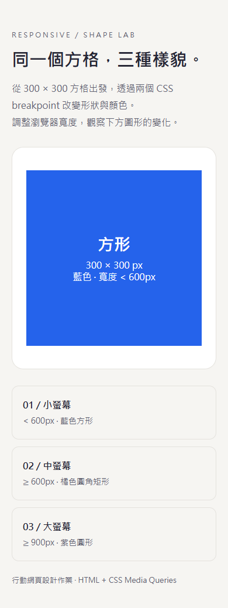
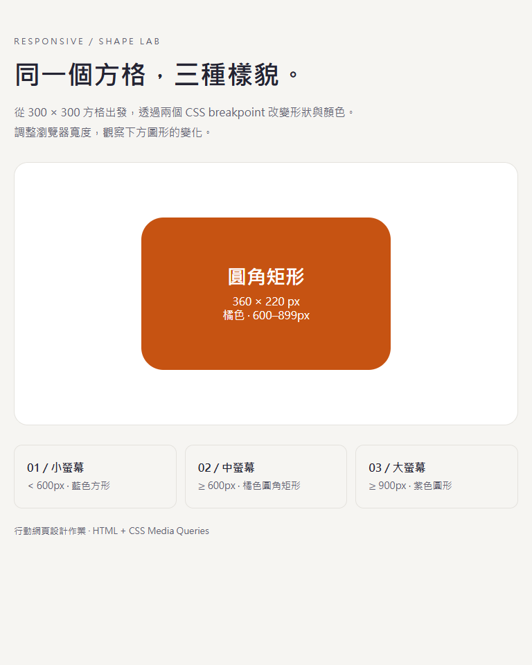
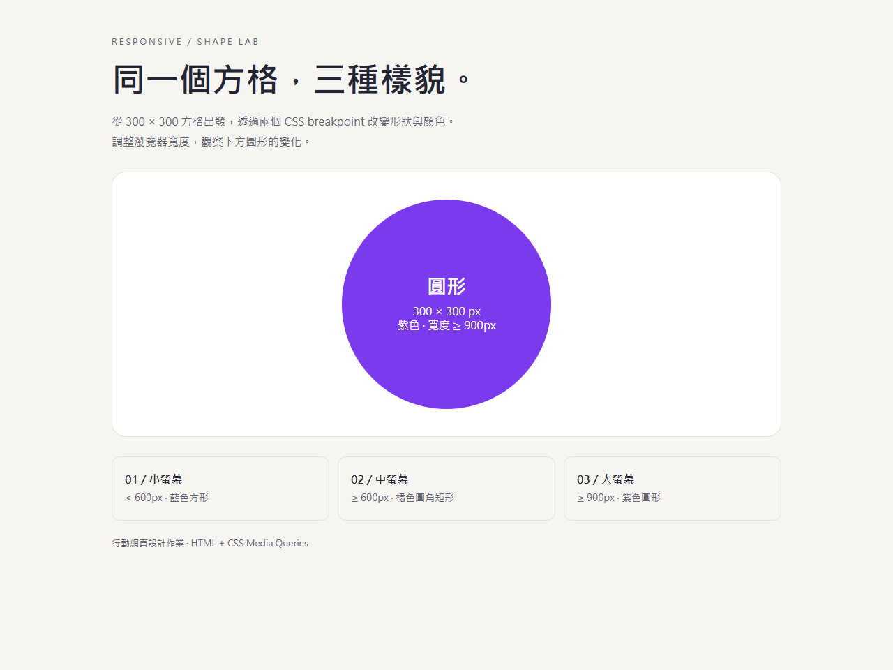

# 響應式方格作業

展示網址：https://opchannelyeayo-dotcom.github.io/responsive-shapes/

以原生 HTML/CSS 製作，僅使用兩個 breakpoint：600px 與 900px。

| 瀏覽器寬度 | 形狀 | 尺寸 | 顏色 |
| --- | --- | --- | --- |
| 小於 600px | 方形 | 300 × 300px | 藍色 |
| 600–899px | 圓角矩形 | 360 × 220px | 橘色 |
| 900px 以上 | 圓形 | 300 × 300px | 紫色 |

## 三種尺寸畫面

### 390px：小螢幕

### 768px：中螢幕

### 1280px：大螢幕

直接開啟 index.html 即可預覽。
